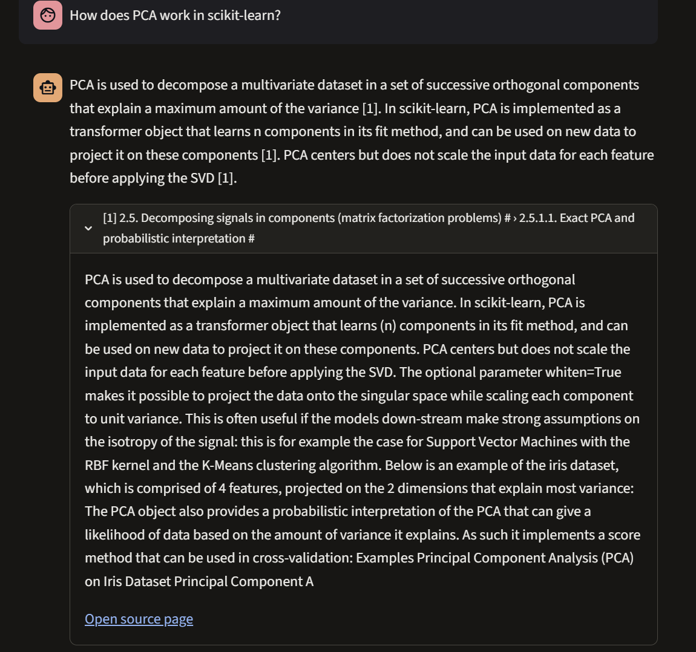
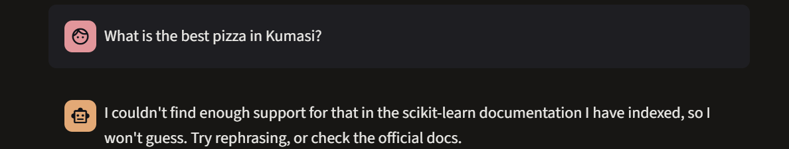

# RAG Document Assistant for scikit-learn Docs






A local chatbot that answers questions from the scikit-learn User Guide, **cites its sources**, and **refuses** when the docs don't support an answer. Runs fully offline with Ollama (no API key).

## How it works
1. **Ingest** (`ingest.py`): scrapes 40 User Guide pages, splits by heading (long sections get overlapping chunks), embeds with `all-MiniLM-L6-v2`, stores 1,177 chunks in ChromaDB.
2. **Retrieve** (`rag.py`): top-8 chunks by cosine distance; chunks above a distance threshold are discarded.
3. **Generate**: a prompt with numbered sources goes to a local Llama 3.1 8B (via Ollama) with rules to cite `[n]` and answer `INSUFFICIENT_CONTEXT` when the sources fall short.
4. **Guardrails**: refuse if retrieval is weak, if the model refuses, or if citations are missing or invalid. Near-duplicate sentences are removed in code.
5. **UI** (`app.py`): Streamlit chat showing the answer and expandable cited passages with source links.

## Run it
```bash
pip install -r requirements.txt
ollama pull llama3.1:8b          # install Ollama first: https://ollama.com
python ingest.py                 # once
streamlit run app.py             # chat UI
python eval.py                   # test set -> eval_results.csv
```

## Evaluation
19 test questions: 10 answerable, 9 that must be refused (off-topic, sklearn-sounding but not covered, prompt injection / role-play attacks).

- **Refusal behaviour:** 19/19 correct. Of the 9 refusals, 6 were stopped by the retrieval threshold and 3 by the model itself.
- **Answer quality (manual, 0-2 per answer):** about 1.8 / 2 across the 10 answered questions.

Note: two refusal tests were swapped after an early run showed my labels were wrong (the docs did mention GPU and XGBoost in passing), so the refusal score is partly tuned to this test set.

## What I changed along the way
- `TOP_K` 5 -> 8 and a longer-answer prompt made answers fuller (bagging vs boosting, GridSearchCV).
- That prompt initially produced a factual error (precision/recall described wrongly) and padding; a stricter prompt fixed the error, and a code-level dedupe removed repeated sentences.
- Auto-pass (answered vs refused) stayed 100% throughout, while manual review still caught real errors. Groundedness checks are not correctness checks.

## Known limitations
- **Tangents:** the 8B model sometimes appends a cited but irrelevant sentence, and in one case an inaccurate one (C vs nu in nu-SVC).
- **Over-generalisation:** a narrow passage can be stretched into a broad claim (an early run said scikit-learn has "no GPU support" from the MLP page alone).
- **Citation check is shallow:** it requires valid citation numbers, not that each sentence is supported by its source.
- Test set is small (19 questions) and written by the author.

## Ideas
Hybrid search (BM25 + vectors), a reranker, per-sentence entailment checks, a larger test set.

## API
```bash
python -m uvicorn api:app --reload      # http://127.0.0.1:8000/docs
```
`POST /ask` with `{"question": "..."}` returns `answer`, `sources`, `refused` and `reason`. `GET /health` checks the service is up. Returns 503 if Ollama is not running.


## Docker
Requires Docker Desktop and Ollama running on the host machine (the container reaches it via `host.docker.internal`).

    docker build -t rag-doc-assistant .
    docker run --rm -v chroma_data:/app/chroma_db -v hf_cache:/app/.cache/huggingface rag-doc-assistant python ingest.py
    docker run --rm -p 8000:8000 -v chroma_data:/app/chroma_db -v hf_cache:/app/.cache/huggingface rag-doc-assistant

The first `docker run` builds the vector database into a Docker volume; the second starts the API on http://localhost:8000 (docs at `/docs`). `requirements-docker.txt` is the dependency list used by the image (Streamlit, FastAPI, ChromaDB, sentence-transformers).

## Tests and CI
`python -m pytest` runs 12 unit tests (guardrails, citation checks, deduplication, API behaviour) with the LLM and vector DB stubbed out. GitHub Actions runs them on every push. The 19-question evaluation (`eval.py`) needs Ollama, so it runs locally, not in CI.


### Chat page in Docker
To run the Streamlit chat UI from the same image (open http://localhost:8501):

    docker run --rm -p 8501:8501 -v chroma_data:/app/chroma_db -v hf_cache:/app/.cache/huggingface rag-doc-assistant python -m streamlit run app.py --server.address 0.0.0.0 --server.port 8501 --server.headless true
